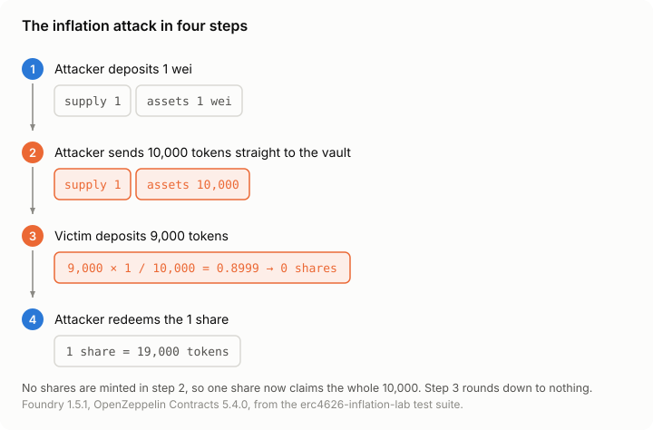
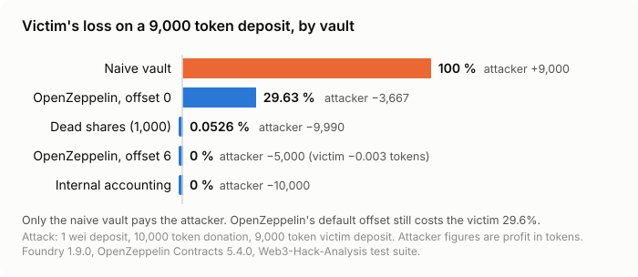
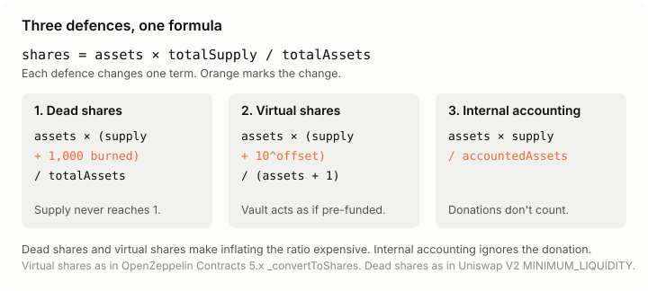
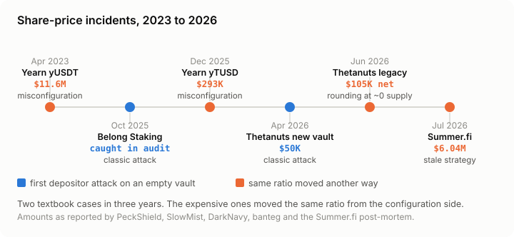

# ERC-4626 Inflation Attack

Self-contained Foundry case folder for the ERC-4626 inflation attack (first depositor attack): the attack vector, the three defences that hold, the one "fix" that does not, and mock replications of the three incident classes seen in production between 2023 and 2026.

Everything here is a teaching mock. No forks, no real addresses, no runnable exploit against a live contract. Unaudited; local Anvil only.

Companion article: "ERC-4626 Inflation Attack: 3 Defences That Hold, 1 That Fails".

## Layout

```text
erc4626-inflation-attack/
├── src/
│   ├── MockToken.sol
│   ├── vaults/
│   │   ├── NaiveVault.sol               # the vulnerable vault (+ optional revert-on-zero flag)
│   │   ├── DeadSharesVault.sol          # defence 1: seed deposit, shares burned to 0xdead
│   │   ├── OffsetVault.sol              # defence 2: OpenZeppelin virtual shares, configurable offset
│   │   └── InternalAccountingVault.sol  # defence 3: totalAssets() is a tracked variable
│   └── incidents/
│       ├── MisconfiguredLenderVault.sol # Yearn yUSDT (2023) / yTUSD (2025) class
│       ├── BasketIndexToken.sol         # Thetanuts legacy index token (June 2026) class
│       └── FleetVault.sol               # Lazy Summer stale-strategy donation (July 2026) class
├── test/
│   ├── helpers/AttackBase.sol           # the four-step attack, reused by every vault test
│   ├── attack/01_InflationAttack.t.sol
│   ├── defences/02_DeadShares.t.sol
│   ├── defences/03_VirtualShares.t.sol
│   ├── defences/04_InternalAccounting.t.sol
│   ├── defences/05_RevertOnZeroShares.t.sol
│   └── incidents/06_MisconfiguredLender.t.sol
│       incidents/07_NearZeroSupplyMint.t.sol
│       incidents/08_StaleStrategyDonation.t.sol
└── illustrations/
    ├── attack/      attack-flow, attack-naive, share-rounding
    ├── defences/    defence-dead-shares, defence-virtual-shares, defence-internal-accounting,
    │                non-defence-revert-on-zero, defences-formula, defence-decision, test-results
    └── incidents/   incidents-timeline
```

## Run

From this folder, with the repo's submodules initialised (`git submodule update --init lib/forge-std lib/openzeppelin-contracts` at the root):

```bash
forge test -vv
```

## The attack (test/attack)

1. Attacker deposits 1 wei and receives 1 share.
2. Attacker transfers 10,000 tokens straight to the vault. No shares minted.
3. Victim deposits 9,000 tokens: `9,000 × 1 / 10,000 = 0.8999`, rounds down to 0 shares.
4. Attacker redeems the 1 share for 19,000 tokens.

Change `DONATION` and `VICTIM_DEPOSIT` in `test/helpers/AttackBase.sol` to your own vault's expected sizes.



## Results (Foundry 1.5.1, solc 0.8.25, OpenZeppelin Contracts 5.4.0)

| Vault | Victim shares | Victim gets back | Attacker profit |
|---|---|---|---|
| Naive, 9,000 deposit | 0 | 0 | +9,000 |
| Naive, 15,000 deposit | 1 | 12,500 | +2,500 |
| Revert on zero shares, 9,000 | reverts | (DoS) | 0 |
| Revert on zero shares, 15,000 | 1 | 12,500 | +2,500 |
| Dead shares, 1,000 | 900 | 8,995.27 | −9,990 |
| OpenZeppelin, offset 0 | 1 | 6,333.33 | −3,667 |
| OpenZeppelin, offset 6 | 1,799,999 | 8,999.997 | −5,000 |
| Internal accounting | 9,000 × 10^18 | 9,000 | −10,000 |



## The defences (test/defences)

| Defence | What changes in the formula | Test |
|---|---|---|
| Dead shares | `totalSupply` never drops below the burned seed | `02_DeadShares` |
| Virtual shares | `(supply + 10^offset) / (assets + 1)`; the offset override is the part teams forget | `03_VirtualShares` (offset 0 and 6) |
| Internal accounting | `totalAssets()` returns a tracked variable, so donations don't count | `04_InternalAccounting` |
| Revert on zero shares | Nothing. Blocks small deposits, misses partial losses | `05_RevertOnZeroShares` |



## The incidents (test/incidents)

Each test replicates the vulnerability class on a mock, not the real contract. Amounts are illustrative; the real figures are in the companion case file.

| Test | Incident class | What the mock shows |
|---|---|---|
| `06_MisconfiguredLender` | Yearn yUSDT (13 April 2023, ~$11.6M), yTUSD (16 December 2025, ~$293K) | A lender slot hardcoded to the wrong receipt token lets a donation inflate pool value; `rebalance()` then redeems it into an unpriced token and the share price collapses while supply stays put |
| `07_NearZeroSupplyMint` | Thetanuts legacy index token (15 June 2026, ~$105K net) | `claim()` drains the basket to dust; `mint()` then rounds every requirement to 0, and each free mint raises the next free amount. 38 mints re-create the whole borrowed supply (37 in the real trace). Includes the one-line fix |
| `08_StaleStrategyDonation` | Lazy Summer (6 July 2026, ~$6.04M) | A capped but not removed strategy adapter still feeds `totalAssets()`; donating an impaired token to it moves the share price and the payout comes from the liquid buffer. Includes the fix: remove, don't cap |



## Rebuilding the illustrations

The figures are generated from the writing-studio illustration design system (`design/examples/erc4626_figures.py` in that repo). SVG is the source; `png/` folders hold 2× exports.
